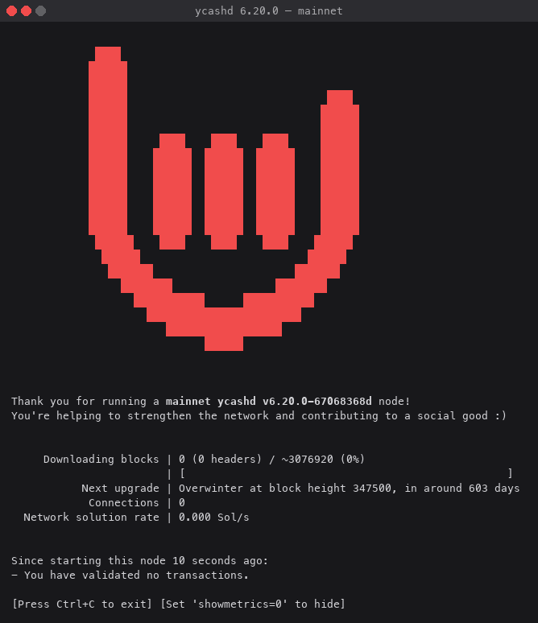

Ycash 6.22.0-rc1 with post-quantum vaults and Ycash Yellowback (YED)

===========

This is the Ycash node on the Zcash 6.20.0 code base, plus a proposed network upgrade: a
**post-quantum vault system** for Ycash, with the applications built on it. Everything above
[What is Ycash?](#what-is-ycash) is about that upgrade; the rest is the Ycash README.

> **Status: in development.** Everything runs on regtest and on a one-laptop devnet. No activation
> height is set on mainnet or testnet, and the upgrade has not been adopted by the Ycash
> Foundation.

## Which repository is which

The upgrade is built on two node lines that carry the same rules and must stay in step:

| Repository | Node | Role |
|---|---|---|
| **ycash6** (this one) | `ycashd` 6.20.0 (Zcash 6.x code base) | the **release line**: tagged releases are built here |
| [ycash-dd](https://github.com/boyfromcave/ycash-dd) | `ycashd` 4.5.0 | where changes land first |

The project workspace, with the plans, the specs and every other component (wallets,
lightwalletd, the bridge attestor, the pool), is
[boyfromcave/yellowback](https://github.com/boyfromcave/yellowback).

## What the upgrade adds

```text
  Yellowback          wYEC bridge         nYEC bridge
  (YED, a dollar)    (to Ethereum)       (to NEAR)
        │                  │                   │
  ┌─────┴──────────────────┴───────────────────┴─────┐
  │  Post-quantum vault system                       │
  │  lock / unlock, signer sets, owner recovery      │
  │  a network upgrade, checked by every node        │
  └──────────────────────────────────────────────────┘
```

### The vault system

- **Vaults** lock YEC under rules that every node enforces, not just miners. Taking YEC out is a
  **release**: a signer set approves it, it waits as a **pending release** for a fixed delay, and
  it can be cancelled during that delay.
- **Signer sets** are groups of members who post a YEC bond. A member who cheats loses the bond;
  a member who leaves stays slashable through an exit window of at least 14 days on mainnet.
- **Owner recovery:** a vault's owner can always reclaim the YEC if its signer set goes silent.
- **Post-quantum signatures:** one new opcode, `OP_CHECKPQSIG`, checks hash-committed
  post-quantum keys. Every vault owner signs with **SLH-DSA** (FIPS 205); YED holders and
  transfers use **Falcon-512** from the first block of the upgrade. Plain YEC can use
  post-quantum addresses too (`sq…` on mainnet). The shielded (Sapling) pool is unchanged.

The vault system is general-purpose: it knows nothing about dollars or other chains.

### Applications

- **Ycash Yellowback (YED)**, a dollar backed by YEC locked in vaults (`1 YED = $1`). Lock YEC
  to mint YED; burn the YED to get the YEC back, which the owner can always do, even if the
  attestors go silent. A vault whose YEC falls below 125 % of the YED it backs can be claimed by
  others, through a pending release that Yellowback's signer set can cancel if it is wrong. The
  YEC/USD price comes from mining pools and from **attestors**, bonded members of an open signer
  set of up to 15 members whose 9 highest-ranked hold the price seats (bond 10,000–20,000 YEC,
  scaling with the collateral locked in YED vaults; a larger bond can take a seat). YED is the one
  registered rule module on the vault system; mainnet YED addresses start with `yb…`.
- **wYEC**, wrapped YEC on Ethereum, backed 1:1 by YEC in vaults. Ycash never reads Ethereum;
  this repository holds only the Ycash side, which needs nothing beyond the vault system.
- **nYEC**, wrapped YEC on NEAR with the same design; the bridge attestor (hawkeye) supports both
  bridges. Neither bridge's contracts are deployed yet.

**Naming:** Yellowback is the system, YED is the unit: "250 YED", "Yellowback is a dollar on
Ycash".

### Status

| | |
|---|---|
| Vault upgrade | Built on both node lines, running on regtest and the devnet |
| Post-quantum layer | Built on the `upgrade/quantum-vaults` branch; it joins `upgrade/vault` at release |
| Mainnet / testnet | **No activation height set.** The vault upgrade is a **hard fork**: once a height is set, every node must upgrade before it |
| Reviews | Internal security and consensus audits (in the workspace's `docs/audits/`). No external audit yet |

Attestor and bridge signer keys are still secp256k1; a post-quantum design for them is being
studied.

## Try it

This brings up a local test network of eight regtest nodes on one machine (upgrade active,
Falcon active as on mainnet), mints YED, and makes a wYEC bridge round trip with a mock
Ethereum. You need `src/ycashd` and `src/ycash-cli` built (see
[Build and test](#build-and-test)), the attestor agent built (`cargo build --release` in
`contrib/yellowback/attest`), and the project workspace's Python venv (the scripts need
`simplejson`). From the repository root inside the workspace:

```bash
source ../.venv/bin/activate
export PATH="$PWD/contrib/yellowback/devnet:$PATH"

yellowback-devnet up                                     # ~6 min: 8 nodes, upgrade active, prices flowing
yellowback-devnet cli -- yed_mint 10000 48 "" "" false   # mint 100 YED (amounts in cents), YEC locked 48 blocks
yellowback-devnet mine 30                                # confirms the mint; matures coins the bridge needs
yellowback-devnet cli -- yed_getbalance                  # "confirmedCents": 10000

yellowback-devnet bridge up --shape relayer              # a bridge signer set and its daemon
yellowback-devnet bridge lock 20                         # lock 20 YEC in a bridge vault
yellowback-devnet mine 20                                # a new set releases nothing in its first 20 blocks
yellowback-devnet bridge burn 3 $(yellowback-devnet cli -- getnewaddress)   # a mock wYEC burn of 3
yellowback-devnet mine 1                                 # the signers post the pending release
yellowback-devnet mine 7                                 # the 6-block delay passes; the YEC is paid out
yellowback-devnet bridge status                          # the burn, its pending release, the release txid

yellowback-devnet bridge down && yellowback-devnet down --wipe
```

The mint's owner is a fresh SLH-DSA key and its YED goes to a Falcon holder address, both
chosen by the wallet. `yellowback-devnet --help` lists every command;
[contrib/yellowback/devnet/README.md](contrib/yellowback/devnet/README.md) covers the end-to-end
walk (section 6) and the post-quantum regimes (section 8).

## For developers

- **The upgrade:** `Consensus::UPGRADE_VAULT`, consensus branch ID `0x6d5b7a31` ("Vault"), in
  `src/consensus/upgrades.cpp`; `src/chainparams.cpp` gives it no height on mainnet or testnet.
  The post-quantum layer rides the same upgrade: no new branch ID.
- **Script:** BIP68 relative lock-times with `OP_CHECKSEQUENCEVERIFY` (`0xb2`), and three new
  opcodes: `OP_CHECKSETSIG` (`0xc0`), `OP_CHECKSETDORMANT` (`0xc1`) and `OP_CHECKPQSIG` (`0xc2`;
  scheme `0x01` SLH-DSA-SHA2-128s, `0x02` Falcon-512). A vault is the output template **V**, a
  pending release the template **I** (an *intent* in the code). Signer-set acts (`SET_CREATE`,
  `SET_JOIN`, …) travel in a `YV` `OP_RETURN`; set state lives in `<datadir>/vaults/`.
- **Post-quantum crypto:** verification only in consensus, from vendored C libraries under
  `src/crypto/pq/` (its `README.md` records sources, commits and licences).
- **YED** is the rule module tagged `YED\0`. Its ledger is an index under
  `<datadir>/yellowback/`; because its rules are consensus, a node whose index is unhealthy stops.
- **Fees:** the YED protocol fee is priced in dollars and tiered by debt; wallets price network
  fees in dollars per KB at the attested price, with `-pqfeerate` as the fallback when no price
  exists.
- **RPCs:** 23 `set_*` / `vault_*` calls ([doc/vault-rpc.md](doc/vault-rpc.md), machine-readable
  in `doc/vault-rpc-contract.json`) and the `yed_*` calls at `rpcversion` 8
  ([doc/yellowback-rpc.md](doc/yellowback-rpc.md)).
- **Wallet keys:** post-quantum keys derive from the wallet's seed; `-mnemonicfile=<file>`
  restores a new wallet from its recovery phrase alone.
- **librustzcash:** `Cargo.toml`'s `[patch.crates-io]` points every `zcash_*` crate at
  [boyfromcave/librustzcash6](https://github.com/boyfromcave/librustzcash6), which adds
  `NetworkUpgrade::Vault` / `BranchId::Vault = 0x6d5b7a31` so the Rust side knows the new epoch.
  The post-quantum layer needs no change there.
- **Releases** of this line are tagged by `.github/workflows/yellowback-release.yml`
  ([doc/yellowback-release.md](doc/yellowback-release.md)): 6.22.x for the vault upgrade,
  6.21.x for the `harden/yellowback` fallback. The version the post-quantum layer ships under is
  chosen at its release.
- **Regtest by hand:** `-nuparams=6d5b7a31:<height>` activates the upgrade, `-pqfalcon=1` (or
  `-pqfalconheight=<h>`) activates Falcon, and YED also needs `-yellowbackattestorset=<setid>`,
  the txid of its signer set's `SET_CREATE`. They go on top of the `-nuparams` for Ycash's earlier
  upgrades (`yellowback_node_args` in `qa/rpc-tests/test_framework/yellowback_util.py`).
- **The fork delta:** `git diff ycash6-legacy...upgrade/quantum-vaults` (`ycash6-legacy` is
  ycashd 6.20.0 as published).

| Path | Contents |
|---|---|
| `src/vault/` | The primitive: acts, set-signature checker, set state and its database, V / I templates, module table, block and mempool glue |
| `src/crypto/pq/` | SLH-DSA and Falcon-512 (vendored), the scheme table, wallet-side signing |
| `src/script/`, `src/primitives/transaction.h` | The opcodes, the V, I and post-quantum standard templates, BIP68 sequence locks |
| `src/main.cpp`, `src/txmempool.cpp`, `src/miner.cpp`, `src/rpc/mining.cpp` | Block connect / disconnect, mempool acceptance, block templates (built against a running copy of the set state, `vault::TemplateRun`) |
| `src/yellowback/` | YED: parameters, payload, prices and attestation, index, the rule module, wallet glue |
| `src/rpc/vault.cpp`, `src/rpc/yellowback.cpp`, `src/rpc/yellowbackwallet.cpp` | The RPCs |
| `contrib/yellowback/` | The pool quote agent, the attestor agent (`attest/`), the devnet (`devnet/`) |

### Build and test

The full recipe, including the macOS host conditions, is in [doc/yellowback.md](doc/yellowback.md),
*Build and test baseline (ycashd 6.20.0)*, and what the 6.20.0 pin needed is in
[doc/yellowback-baseline.md](doc/yellowback-baseline.md). In short:

```bash
./zcutil/build.sh -j8                                       # cold: ~35 min (depends builds clang and Rust)
make -C src -j8 ycashd ycash-cli test/test_bitcoin          # incremental

src/test/test_bitcoin --run_test='vault_*,pq_*,yellowback_*'
qa/pull-tester/rpc-tests.py -j4 --nozmq vault_upgrade vault_primitive vault_pq vault_bridge \
    yellowback_upgrade yellowback_lifecycle yellowback_claim yellowback_pq yellowback_fees
```

Use the workspace venv's Python for the functional tests and the devnet; a single functional
script reads the node binary from `ZCASHD` (not `BITCOIND` as on the 4.5 line).

## Documentation

| Document | What it covers |
|---|---|
| [doc/yellowback.md](doc/yellowback.md) | Using YED from `ycash-cli`, configuration, backups, the build |
| [doc/vault-rpc.md](doc/vault-rpc.md) | The vault and signer-set RPCs |
| [doc/yellowback-rpc.md](doc/yellowback-rpc.md) | The `yed_*` RPCs |
| [doc/yellowback-attestor.md](doc/yellowback-attestor.md), [doc/yellowback-mining.md](doc/yellowback-mining.md) | Running an attestor; mining pools |
| [doc/yellowback-spec.md](doc/yellowback-spec.md) | The YED protocol and its trust statement |
| [doc/yellowback-review.md](doc/yellowback-review.md) | A review guide to the fork's changes |
| [doc/yellowback-release.md](doc/yellowback-release.md) | How releases are built and tagged, and what their notes must say |
| [contrib/yellowback/devnet/README.md](contrib/yellowback/devnet/README.md) | The local test network in full |

The design documents (the upgrade plan, the quantum plan and spec, the fees spec) are in the
[project workspace](https://github.com/boyfromcave/yellowback). The `harden/yellowback` branch
keeps an earlier version of Yellowback that needs no network upgrade, as a fallback.

What is Ycash?
--------------

Ycash is a digital currency. For more information, see [y.cash](https://y.cash).

For a comparison of Ycash to Bitcoin, see the [Ycash fact sheet](https://y.cash/fact-sheet).

Ycash is a chain fork of Zcash: it shares Zcash's history up to the fork and
its privacy technology (shielded Sapling transactions built on zero-knowledge
proofs), and has followed its own chain since.

## The `ycashd` Full Node

This repository hosts `ycashd`, the Ycash consensus node, together with
`ycash-cli` (its RPC client) and `ycash-gtest` (its unit tests). It downloads
and stores the entire history of Ycash transactions; depending on the speed of
your computer and network connection, the synchronization process could take
a day or more. The node reads its settings from `ycash.conf` in its data
directory (`~/.ycash` on Linux, `~/Library/Application Support/Ycash` on macOS,
`%APPDATA%\Ycash` on Windows). If you are upgrading from Ycash 4.4.4 or 4.5.0,
the binaries (`ycashd`, `ycash-cli`), `ycash.conf` and the data directory
locations are unchanged.

<p align="center">
  
  <br>
  <em>The startup screen, captured from <code>ycashd</code> v6.20.0 on a fresh, unconnected mainnet data directory.</em>
</p>

This is the Ycash node rebased by the Ycash developers onto the Zcash 6.20.0
code base. The Zcash code is in turn derived from a source fork of
[Bitcoin Core](https://github.com/bitcoin/bitcoin), initially from Bitcoin Core
v0.11.2; the codebases have since diverged substantially.

**Ycash is experimental and a work in progress.** Use it at your own risk.

## Getting Started

Ycash is a chain fork of Zcash, so for most topics, including `zcashd`
internals, the Zcash documentation applies: see the
[zcashd user guide](https://zcash.readthedocs.io/en/latest/rtd_pages/zcashd.html).
Read `zcashd` as `ycashd`, `zcash-cli` as `ycash-cli` and `zcash.conf` as
`ycash.conf`.

### Need Help?

* Visit [y.cash](https://y.cash).
* Ask for help in one of the [Ycash forums](https://y.cash/forums).

Participation in the Ycash project is subject to a
[Code of Conduct](code_of_conduct.md).

### Building

Build Ycash along with most dependencies from source by running the following command:

```
./zcutil/build.sh -j$(nproc)
```

This produces `src/ycashd` and `src/ycash-cli`; `make check` also builds and
runs `src/ycash-gtest`. The build prerequisites are those of `zcashd`; see the
[zcashd install instructions](https://zcash.readthedocs.io/en/latest/rtd_pages/zcashd.html#install).

### Deprecation Policy

Unlike upstream Zcash, Ycash does not shut a node down at a deprecation
height: the automatic deprecation shutdown is disabled (see
[src/deprecation.h](src/deprecation.h)), and the RPC features upstream
deprecates stay enabled by default (`-allowdeprecated`).

License
-------

For license information see the file [COPYING](COPYING).
